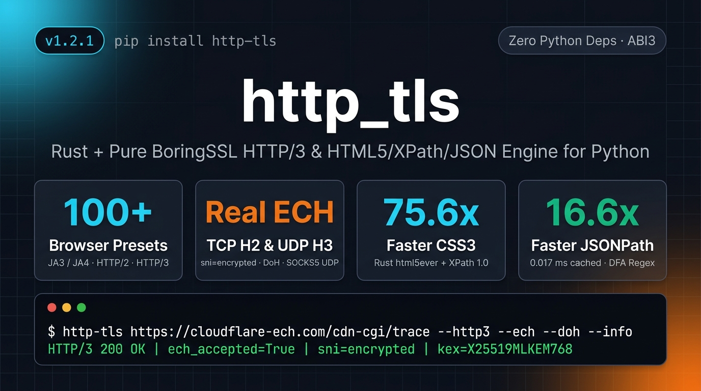

# `http_tls`



Standalone **Rust + Pure BoringSSL** HTTP/1.1, HTTP/2, and UDP QUIC HTTP/3 client & **100% Pure Rust HTML5 CSS3 / XPath 1.0 / JSON Path / DFA Regex** extraction engine for Python — shipped in a single ABI3 wheel with **zero Python runtime dependencies**.

```bash
pip install http-tls
```

## Core Pillars

- **Byte-Exact Browser Fingerprints (100+ Presets)**: Authentic BoringSSL JA3/JA4, GREASE, ALPS, Post-Quantum `X25519MLKEM768`, and Akamai HTTP/2 frame order for Chrome, Edge, Safari, Firefox, Opera, OkHttp, and Tor.
- **Pure BoringSSL HTTP/3, Real ECH & Session-Wide DoH**: Real Encrypted Client Hello (`sni=encrypted`) on both TCP HTTP/2 and UDP QUIC HTTP/3, SOCKS5 UDP Associate, TLS 1.3 ticket resumption (`resp.tls_resumed`), and concurrent dual-stack DNS-over-HTTPS (`doh=True`).
- **Built-in Pure Rust Extraction**: `html5ever` CSS3 (`75x` faster than `BeautifulSoup`), native XPath 1.0, cached `serde_json` JSON Path with filter predicates (`0.017 ms`), and cached ReDoS-safe DFA regex.
- **Triple Drop-in API + GIL-Free `gather()`**: Compatible with `requests`, `httpx`, and `curl_cffi`, plus native Tokio async and synchronous `session.gather(urls, concurrency=50)`.
- **Standalone C-ABI Shared Library (`http_tls.dll` / `.so` / `.dylib`)**: Call the full BoringSSL + HTTP/3 + Real ECH + Streaming + Full-Duplex WebSocket + Rust Extraction engine directly from **C#, Go, Node.js, C/C++, and PHP** with zero Python runtime — see [C-ABI Shared Library](c-abi.md).
- **Built-in CLI Debugger**: Run `http-tls <url> --http3 --ech --find "$.tls.ja4"` directly from your terminal.
